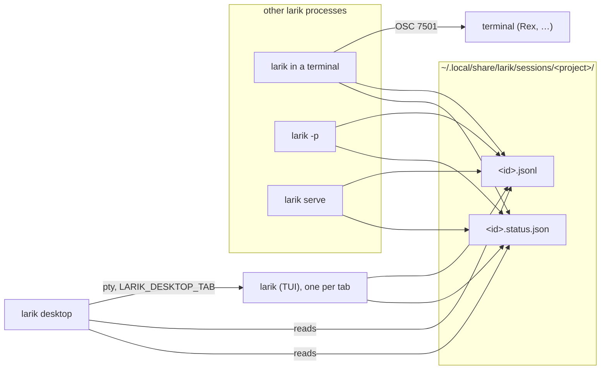

# Desktop app plan

A desktop window for Larik that shows every session from every project in one place, says which ones need you, and lets you work in any of them. Each open session is a terminal tab running the `larik` CLI, so the window is a terminal built around Larik's sessions rather than a second front end: everything the TUI does works there unchanged. It ships inside the `larik` binary as `larik desktop`, so there is nothing else to install.

This is a plan, worked through in phases. Each phase is useful on its own and lands before the next one starts. The status column below is kept up to date.

| # | Phase | Status |
|---|---|---|
| 1 | [Session status model and OSC 7501](#phase-1-session-status-model-and-osc-7501) | Done |
| 2 | [Live status files](#phase-2-live-status-files) | Done |
| 3 | [Cross-project session index](#phase-3-cross-project-session-index) | Done |
| 4 | [MyGo spike](#phase-4-mygo-spike) | Done |
| 5 | [Desktop shell: window, sidebar, terminal tabs](#phase-5-desktop-shell) | Done |
| 6 | [Panes: splits and changes](#phase-6-panes) | Done |
| 7 | [Inbox, notifications, keyboard, launcher](#phase-7-inbox-notifications-keyboard-launcher) | Done |
| 8 | [Commands and sidebar details](#phase-8-commands-and-sidebar-details) | Done |
| 9 | [Attention while the window is in front](#phase-9-attention-while-the-window-is-in-front) | Done |
| 10 | [Terminal tabs](#phase-10-terminal-tabs) | Done |
| 11 | [Answering in place](#phase-11-answering-in-place) | Done |
| 12 | [Worktrees](#phase-12-worktrees) | Done |
| 13 | [Changes you can act on](#phase-13-changes-you-can-act-on) | Done |
| 14 | [Cost and context](#phase-14-cost-and-context) | Done |
| 15 | [Command palette](#phase-15-command-palette) | Done |
| 16 | [Panes, any number, both ways](#phase-16-panes-any-number-both-ways) | Done |
| 17 | [Hunks and lines](#phase-17-hunks-and-lines) | Done |
| 18 | [Tabs that outlive the window](#phase-18-tabs-that-outlive-the-window) | Done |
| 19 | [Names, archiving and the Trash](#phase-19-names-archiving-and-the-trash) | Done |
| 20 | [Browser tabs](#phase-20-browser-tabs) | Done |
| 21 | [New tab chooser](#phase-21-new-tab-chooser) | Done |
| 22 | [Tiling](#phase-22-tiling) | Done |
| 23 | [Answers from the notification](#phase-23-answers-from-the-notification) | Done |
| 24 | [Appearance and keys](#phase-24-appearance-and-keys) | Done |
| 25 | [Remote windows](#phase-25-remote-windows) | Done |
| 26 | [What's next](#phase-26-whats-next) | Planned |

## The design we're aiming for

The reference is [Rex](https://www.superlogical.com/rex), a terminal from Superlogical. What we take from it (its look we later left for macOS's own: see **macOS look** under phase 7):

- **One dark, translucent window** with the traffic lights and a host chip at the top left, and the open sessions as pill-shaped tabs in the title bar. Each tab carries a program icon and a thin coloured status stripe.
- **Content as tiled cards.** Each pane is a rounded card with a header: an icon, a title, and the directory (`Stress-test Snake demo | rex-snake`, `Git Changes ~/Sites/rex-snake`), and on the right split-horizontal, split-vertical, maximize and close buttons. Panes split freely in both directions.
- **Terminals as the content.** Rex's panes are terminals; ours run `larik`, so a session looks and behaves exactly as it does in any terminal.
- **Program status** as a protocol, not a guess: programs report `idle`, `working`, `done`, `blocked` (with a kind: `permission`, `question`, `auth`) or `error` over [OSC 7501](https://www.superlogical.com/rex/docs/build/program-status), and the window shows a spinner for working, symbols for blocked, and a marker for finished work you haven't looked at.

What we add for Larik:

- **A sidebar of every session from every project**, grouped by the directory it ran in. Rex's session picker shows terminals; ours shows Larik sessions, including ones that ran in a terminal and ones that ran here.
- **A footer** at the bottom of the sidebar: larik's version, and a newer release when there is one; counts of what's blocked on you, failed, or finished and unread, across all projects, only while there are any; and, while several sessions are selected, what to do with them all.

```
┌ ● ● ●  larik ─ MacBook   ( ⠋ refactor parser │ ⏸ add OSC 7501 │ ✓ release notes )        ⌘  + ┐
├──────────────────────┬────────────────────────────────────────┬──────────────────────────────┤
│ ▾ larik-hardness  ●2 │ >_ refactor the parser | larik-hardness│ ± Changes ~/Code/larik-…     │
│   ⠋ refactor parser  │ ▰▰▰ larik v0.25.0 · ~/Code/larik-…     │ M internal/parser/lex.go     │
│   ⏸ add OSC 7501     │ • Ran go test ./internal/parser        │ @@ -1,8 +1,11 @@             │
│   ✓ release notes    │   └ ok  larik/internal/parser 0.41s    │ -const WIDTH = 24            │
│   · fix trace view   │ • I split the lexer into …             │ +let WIDTH = 24              │
│ ▾ ornith/page        │                                        │                              │
│   ✕ deploy check     │ ┌──────────────────────────────────┐   │                              │
│ ▸ test-larik      2  │ │ › Ask larik…                     │   │                              │
│ ──────────────────── │ └──────────────────────────────────┘   │                              │
│ Inbox  1⏸ 1✕ 1✓      │                                        │                              │
└──────────────────────┴────────────────────────────────────────┴──────────────────────────────┘
```

## Architecture



- **Status is derived once** (`internal/status`) and published two ways: as OSC 7501 to the terminal the TUI runs in, and as a small status file next to the session that any process can read.
- **Each tab is a terminal running `larik`** (`larik --resume <id>` for a session from the sidebar), with MyGo's terminal plugin, which emulates it with Ghostty's libghostty-vt. The agent runs in its own process, as in any terminal, so a crash or a stuck tool can't take the window down, and there is no second front end to keep in step with the TUI.
- **The desktop reads the disk for the sidebar.** A tab's larik gets `LARIK_DESKTOP_TAB` in its environment and writes it into its status file, so the window knows which session a new tab went on to create, or switched to with `/resume`.
- **A session runs in one place.** A session file is locked by the process writing it, so a session open in another terminal shows its live status in the sidebar, and the window says where it is rather than opening a second larik on it.

## Phase 1: Session status model and OSC 7501

`internal/status` defines the five states, the three blocked kinds and a `Report` (state, kind, title, message). `osc.Status` encodes a report as OSC 7501: `ESC ] 7501 ; state=…:kind=…:app=larik:title=<base64>:msg=<base64> BEL`, within the spec's limits.

The TUI derives its report from its own state after every update and writes OSC 7501 only when it changes:

| TUI state | Report |
|---|---|
| a permission prompt is open | `blocked`, kind `permission` (`question` for `ask_user`), message says what for |
| a turn, recording or background task is running | `working` |
| the last turn failed | `error` |
| the last turn finished | `done` |
| just started, or the last turn was interrupted | `idle` |

On exit it sends `state=clear`, so a terminal doesn't keep showing a session that is no longer there. Terminals without OSC 7501 ignore the sequence. `"program_status": false` in config turns it off.

## Phase 2: Live status files

Every front end that owns a session (TUI, `-p`, `serve`) writes `<id>.status.json` next to `<id>.jsonl` when its report changes:

```json
{"pid": 4242, "state": "blocked", "kind": "permission", "msg": "needs your permission to use bash", "front_end": "tui", "updated": "2026-11-02T10:04:05Z"}
```

Writes are atomic (temp file and rename). A reader treats `working` and `blocked` from a process that is no longer running as `idle`, the same rule OSC 7501 gives terminals; `done` and `error` stay until the session is opened again.

## Phase 3: Cross-project session index

`session.Index(dataDir)` walks every project folder under `sessions/` and returns projects with their sessions and live status:

- **Grouped by the directory recorded in each session** (`meta.cwd`), not the folder name: older folders without a hash and the current hashed ones hold sessions for the same project.
- **Subfolders and worktrees grouped under their git repository**, each session labelled with its subfolder.
- **Scratch directories hidden** (anything under the system temp folders) unless asked for, and projects whose folder is gone marked as missing.
- Projects sorted by latest activity; sessions newest first.

`larik sessions` prints the index (`--all` includes scratch directories, `--json` for scripts and the desktop app).

## Phase 4: MyGo spike

The desktop uses [MyGo](https://mygo.egoist.dev)'s native UI: Go views drawn on the GPU, no webview and no cgo, so it can be compiled into `larik`. Before building on it, a throwaway spike answers:

1. Does a plain `go build` binary (no app bundle) open a window when run from a terminal on macOS?
2. How does MyGo take the main thread, and can `larik`'s `main` hand it over only for `larik desktop`?
3. Does a binary that links MyGo still start every other command on a Linux machine with no display, GTK or GL? If not, the desktop goes behind a build tag or into a separate binary.
4. Does the Markdown widget keep up with a long streamed reply, and does text selection work across messages?
5. Does IME composition work in the prompt box?
6. How much does it add to the binary size?

### What the spike found (MyGo v0.7.4, November 2026)

| Question | Answer |
|---|---|
| Plain binary, no bundle | **Yes.** A `CGO_ENABLED=0 go build` binary run from a terminal on macOS opened its window and drew it. |
| Main thread | MyGo's `init()` calls `runtime.LockOSThread()`, so the main goroutine stays on the main thread for every command once MyGo is linked, not just `larik desktop`. `mygo.App.Run()` then takes it over. Larik's other commands don't care which thread `main` runs on, so this is harmless, but it is a cost every command pays. |
| Headless Linux | **Should work; not run yet.** On Linux MyGo's `init()` only registers callbacks. GTK, GDK, cairo and GL are loaded with purego when the backend is first created, which happens when the first window opens. Every other command should start without them. This needs one run in a container without GUI libraries before phase 5 ships. |
| Streaming Markdown | `markdown.Stream` redrew at about 65 frames a second while 200 tokens arrived over 2 seconds, in a 480×320 window. Their `markdown-chat` example adds what a chat needs: replies revealed word by word, and a list that follows the end until you scroll up. |
| Selection across messages, IME | Not tested: both need someone at the keyboard. They're checked by hand at the start of phase 5. |
| Binary size | A Markdown window is 15 MB on its own. Linking only the packages adds 2.7 MB to a stripped `larik` (78 → 81 MB); expect 10–15 MB once the desktop uses them. |
| Go version | MyGo needs **Go 1.27.3**. Larik's `go.mod` says 1.27.1, so adding it raises Larik's minimum Go. `GOTOOLCHAIN=auto` (the default) downloads 1.27.3 by itself. |
| Testing | `ui.NewTester(view, w, h)` runs a view with no window, clicks and types as a user would, and `Image()` renders it. So the desktop can be tested in `go test`, and screenshots of it can be made without a display. |
| Terminal | MyGo's terminal plugin loads libghostty-vt (1.9 MB on macOS arm64) at run time, without cgo. Apps built with MyGo's CLI bundle it; a plain `go build` binary like `larik` downloads it once from MyGo's releases into the user's cache, checking its SHA-256. `$MYGO_GHOSTTY_VT` names another copy. It needs macOS 13, glibc 2.28 or Windows 10 1809. |

**Decision:** go ahead with MyGo's native UI, compiled into `larik`. The desktop code goes in `internal/desktop`, and `larik desktop` in `cmd/larik`. If the headless Linux run fails, the desktop moves behind a `desktop` build tag that release builds set on macOS and Windows only.

## Phase 5: Desktop shell

`larik desktop` opens the window from a terminal, detaches so the terminal gets its prompt back, and passes the shell's environment to its tabs (so provider keys work).

The first version of this phase drew Larik's own transcript, prompt box and permission cards, with a `larik serve` per directory behind them. It worked, but it was a second front end that would always trail the TUI: slash commands, `/rewind`, `/trace`, the browser panel, pickers and every shortcut would each need building again. Tabs now run the CLI in a terminal instead, and the window keeps what a terminal can't show: every project's sessions, what each is doing, and the inbox.

Built, in [internal/desktop](../internal/desktop/app.go) and `larik desktop`:

- The window, with a hidden title bar the view draws: the host, a pill per open tab with its status stripe, and a **New** menu for the three tab types.
- The sidebar from the index, refreshed every 1.5 seconds (6 ms on 330 sessions, since each file's scan is kept until it changes): sections per project, a status marker per session, unread checks and crosses, "Show N more", and the inbox with counts that open the newest of each. Sessions with a tab show a terminal icon.
- Terminal tabs: choosing a session runs `larik --resume <id>` in its directory; the toolbar's **New** menu offers a Larik session, a worktree session, or a terminal in the focused pane's directory. A tab follows its larik to whatever session it has open, through the tab tag in the status file. When larik exits cleanly its tab closes; when it fails the tab stays, with what it printed, and shows as an error.
- A card per tab with Rex's header: status icon, session title, project and subfolder, state and model, close.
- A session open in another terminal stays there: choosing it says so, since only one larik can have a session.
- "New session here" at the end of each project's section starts one in that project.
- The tabs come back at the next launch, resumed, with the split and the pane sizes, saved in `desktop/state.json` under the data directory as they change. Tabs that never started a session, and sessions open in another terminal by then, are left out. Without saved tabs the window opens the newest session of the directory it started in, unless that is the home directory, where the launcher starts it.
- Keys: Command+T new tab, Command+W close, Command+1–9 and Command+Shift+[ ] to switch (Control+Shift elsewhere, so Control keys stay larik's).
- `larik desktop` loads the terminal library before detaching, so a failed first download shows in the terminal rather than the log.
- Headless tests render the sidebar with fixture sessions, and run a fake `larik` script in real terminals to check resuming, new tabs, tab tags, failed and clean exits.

Still to check: the headless Linux run from phase 4. Once, on the first launch after the rework, the window drew its first frame and never redrew, while its tab's larik ran; it never came forward as the active app. It hasn't happened on any launch since, with or without detaching, nor in four detached launches against a separate data directory made to catch it.

## Phase 6: Panes

A second pane sits beside the main one, as one of two cards with Rex's header and controls, half and half to start and resizable. Rex splits both ways and as often as you like; one split side by side covers what Larik needs, and keeps the keys simple.

- **Splits**: the split button (⌘D) starts a new session in the focused tab's directory beside the main one; pressed in while split, the button closes the split, as the changes button closes the changes. The pane with the keyboard, in its terminal or its find bar, is the focused one: the sidebar, the title bar, ⌘W and new sessions follow it, and a session chosen in the sidebar opens there. Closing the split leaves its tab open; closing the main pane's tab hands the main pane to the split.
- **Changes** (⇧⌘G): the working tree of the main tab's repository against HEAD, a row per file, as Xcode lists changes, with a disclosure arrow, git's status letters, lines added and removed, and MyGo's diff viewer (unified, wrapped, with syntax colours), read again every two seconds while open, so it follows the agent's edits. Each file keeps its viewer, and whether it's folded, across reads. Up to 60 files show, and binary files and files over 512 KB are named but not shown. The pane follows the main tab: switching it to another project's tab shows that project's changes, and closing the last tab closes the pane and stops reading. Each read takes the files' text at HEAD from the last one while HEAD stays (git runs three times a read rather than once more per file: 190 ms down to 47 ms on a checkout with 41 changes).

The browser and trace panes in the first plan are dropped: the TUI's own browser panel and `/trace` work in a tab as they do in any terminal.

## Phase 7: Inbox, notifications, keyboard, launcher

- **Inbox** of blocked, failed and unread-finished sessions across projects at the bottom of the sidebar (phase 5), and the same count on the Dock icon.
- **Alerts**: when a session becomes blocked, or a turn that was working finishes or fails, while the window isn't focused, the Dock icon bounces and, where the system allows, a notification says which session; clicking it opens the session. macOS shows notifications only for app bundles, so they come with the launcher below, not with `larik desktop` run from a terminal.
- **Keyboard**: ⌘T new tab, ⌘O a new session in a folder you choose, ⌘W close, ⌘1–9 and ⇧⌘[ ] switch tabs, ⌘D split, ⇧⌘D split below, ⌥⌘ and an arrow the pane that way, ⇧⌘↩ zoom a pane (phase 16), ⇧⌘G changes, ⌘J the next session waiting for you (blocked first, then unread), ⌘K search, ⌘B hide or show the sidebar (also the button beside the host name), ⌘+ ⌘− ⌘0 the terminals' text size, all tabs at once, ⌘F find in the focused terminal, ⇧⌘P the command palette (phase 15). The window's keys reach it even while a terminal has the keyboard; the terminal's own ⌘K (clear screen) gives way to search. Off macOS they take Control+Shift.
- **Terminal line movement on macOS**: ⌘← and ⌘→ send Control+A and Control+E to the focused terminal's program, moving to the start or end of an editable command line in zsh and other shell line editors that bind those keys.
- **Held keys on macOS**: held characters repeat instead of opening the accent picker, while input-method composition remains available in terminal tabs and other text fields.
- **Search**: the field at the top of the sidebar (⌘K) narrows every project's sessions to those whose title, project, directory or ID has each word typed, up to 50, across projects, and then those where each word was said: in a prompt or a reply, not in tool output or an attached file, with the passage under the session. Prompts and replies are a sliver of a transcript (4 MB of 788 MB across 542 sessions, on one machine), so the window keeps them in memory once a search first asks, reading them in the background (0.3 s for those 542) and then only what each transcript gained (2 ms), and a search takes a few milliseconds. Searching what was said starts at three letters, before which nearly every session would match. ↑ and ↓ choose a match, highlighted, and Enter opens it (the first to start with) and ends the search; Escape clears it, and a second Escape gives the keyboard back to the terminal.
- **Session menu**: right-clicking a session offers Open, Open in Split, Fork into a New Tab (`larik --resume <id> --fork`, so the original stays as it was), Copy Session ID, and Show Transcript in Finder. Right-clicking a tab in the title bar offers Open in Split, Close Tab, Close Other Tabs, and the last two for its session.
- **Remembered**: besides the open tabs (phase 5), the window keeps the split's width, the sidebar's width, whether it's hidden, which projects are folded, the text size, and the sessions hidden from it.
- **Closing a working tab** asks first, since it stops larik mid-turn; the session stays, so it can be resumed. Idle, blocked and finished tabs close at once, as does a tab whose larik exits cleanly. Closing the window (⇧⌘W or its close button) or quitting (⌘Q) asks the same while any tab is working, through the window's OnClose, which a quit goes through too; the tabs open again next launch.
- **One window**: one runs per data directory. It listens on a socket in the temp folder named after the data directory; a later `larik desktop`, from a terminal or the launcher, hands it the directory it ran in and exits, and the window comes forward on that directory's project: its newest session, or a new one where it has none (the home directory just brings the window forward). A socket left by a window that crashed is taken over. Two windows used to show the same sessions with tabs of their own and save over each other's tabs. MyGo's single-instance lock goes by the app's name, which would make windows on other data directories, as tests run, hand over to yours.
- **Menu bar** (macOS): AppKit hands a Command key to the menu bar before the window, and MyGo's default menu bar gave ⌘W to closing the window, every tab with it, and ⌘+ ⌘− ⌘0 to zooming a page the window doesn't have. Larik's own menu bar gives those keys the window's meanings (⌘W closes the tab, ⇧⌘W the window) and lists the other keys under File, Edit, View and Window. The terminal takes the Edit menu's Copy, Paste and Select All as commands, so those keys keep working through it. The headless tests drive the window's own shortcuts, which never see the menu bar, so this showed only on reading MyGo's AppKit code; a test checks that the menu's keys mean what the window's do and that no two items share one. The Window menu ends with the open tabs, as Safari's and Terminal's do, ⌘1–⌘9 on the first nine and a checkmark on the focused one, the menu bar set again when they change; the Help menu, with macOS's search field, opens Larik's README and this guide. About Larik is AppKit's own panel, told larik's version and name: run from a plain executable rather than an app bundle, it had none to show.
- **Project menu**: right-clicking a project offers New Session Here, Open in Finder, and Copy Path. A changed file in the changes pane offers Open, Show in Finder, and Copy Path.
- **Dock** (macOS): the Dock icon is Larik's, drawn as for the launcher, also when the window runs from a terminal, and its menu lists up to eight sessions waiting for you ("… — needs you", "— failed", "— finished") and New Session; choosing one brings the window forward on it.
- **Find** (⌘F): a bar under the pane's header searches the terminal's screen and scrollback with the terminal library's own search, highlighting matches and counting them ("2 of 5"). Enter goes to the next match up, Shift+Enter back down; Escape clears the text, then closes the bar and gives the keyboard back to the terminal.
- **Tab order**: dragging a tab onto another moves it to that place.
- **macOS look**: the window draws itself as a Mac app does, in place of Rex's warm palette, teal accent, pill tabs and floating cards. The sidebar runs the window's full height in macOS's sidebar material, with the traffic lights and a sidebar button over its top; the content is opaque under a unified toolbar that names the focused session, where it is and what it's doing, with the split and changes buttons and the **New** menu. Tabs show in a tab bar once there are two; each has an icon for Larik, worktree, or terminal, and when more than five are open an overflow menu lists them all while keeping the active tab visible. With one tab, the toolbar's title gives its menu. Panes sit flush, with a slim header naming each only while split and an accent on the focused pane. Colours are macOS's (labels, separators, the system's green, orange and red), the accent is the one chosen in System Settings, icons are drawn thin, confirmations to close a working tab, close the window or quit are the system's sheets, and renaming happens in the sidebar's row, as in Finder. MyGo draws the controls itself, so they are close to AppKit's rather than AppKit's: the menu bar, context menus, Dock, sheets, folder picker and notifications are the system's own.
- **Settings**: ⌘, (Ctrl+Shift+, elsewhere), or Larik › Settings… opens a separate, searchable window with categories and explanatory rows. Its content fills the right pane from the top, without a title bar or duplicate page headings; the sidebar leaves room for the window controls. It edits desktop preferences and personal defaults for new agent sessions: model, reasoning effort, permission mode, execution style, response language, compaction, token saver, prompt suggestions and MCP tool loading. A row shows the effective value when the focused project overrides its personal default. Advanced opens provider connection, routing, permission rules, MCP, hooks, sandbox and the full `larik /config` editor. A command after `larik` runs as if typed; only built-in command names count, so a prompt that starts with a path still goes to the model. The app menu is MyGo's with Settings, About, Services, Hide and Quit.
- **Folders**: ⌘O, or File › Open Folder…, asks for a folder (with a New Folder button) and starts a session in it. A folder dragged from Finder or a file manager onto the sidebar, which lights up under it, does the same; a file starts one in its folder, and several give a tab each. Over a terminal a drop pastes the paths instead, as in any terminal.
- **Dragging sessions**: a session dragged from the sidebar onto a pane opens there: onto the split, into the split; onto the main pane, into it, swapping with the split when it was showing there; onto the split button, into a new split. The pane takes an accent border under it.
- **Window title**: the window is named after the focused tab's session ("… — Larik"), as the Window menu, Mission Control and the app switcher show it.
- **Restarting**: a tab whose larik failed shows a bar over what it printed, with its exit status and a Restart button; Restart, also in the tab's menu, runs larik again in the same tab and place, resuming its session (or a new one if it had none yet).
- **Reopening**: ⇧⌘T, or Reopen Closed Tab in a tab's menu (off macOS, where the window's keys take Shift already), resumes the session of the tab closed last, then the one before, up to 20; one that's gone or open again is skipped.
- **Hiding sessions**: "Hide from Sidebar" in a session's menu left it out of its project's list (search still finds it), and "Show N hidden" under the project brings hidden ones back to view, dimmed, where "Show in Sidebar" unhides one. A hidden session still shows while it's open in a tab or waiting for you, and doesn't count in the inbox once it finishes. Archiving (phase 19) has since taken its place in the menus; sessions hidden before stay hidden until you show them.
- **Renaming**: "Rename…" in a session's or a tab's menu turns the session's sidebar row into a field with the whole name selected, as Finder renames, showing the row first (the sidebar, its project, and the session even if hidden or past the first eight). Enter, or clicking away, names the session, as the sidebar, its tab, the window title, the Dock menu and alerts then show it, in place of its first prompt. The first prompt stays in the session's tooltip and the field's placeholder, and search finds either; a blank name gives the first prompt back, and Escape leaves it as it was. The names are kept beside the transcripts (phase 19), so `/sessions` and `larik --list` show them too.
- **Pinning**: "Pin to Top" in a session's menu moves it into a Pinned section above the projects, with its project's name, in the order pinned; "Unpin" puts it back in its project. Pinning a hidden session shows it again, and archiving a pinned one unpins it. The pins come back next launch; a session that's gone drops out. Dragging a session onto the Pinned section pins it where it's dropped, before the pinned one under it, and dragging pinned ones reorders them; while a session is dragged and nothing is pinned yet, the section shows to drop it on.
- **Ages**: each session in the sidebar shows how long ago it last changed (now, 5m, 3h, 2d, 4w), unless it has a status marker; the date and time are in its tooltip.
- **Launcher**: `larik desktop --install` writes `~/Applications/Larik.app` on macOS, or a `.desktop` entry on Linux, that starts `larik desktop` through your interactive login shell, as Visual Studio Code reads the shell's environment, so provider keys set in your shell profile work. `--uninstall` removes it. The bundle runs `larik` through a link inside it, so macOS takes the process for the app's and lets it show notifications (checked: the window reports them on from the bundle, off from a terminal); the first one asks for permission. The icon, Larik's three bars on the dark card, is drawn with MyGo's own renderer when installing, so there's no image file in the repository. It runs the `larik` you installed it from, so reinstall after moving the binary.

Still open: the headless Linux run from phase 4 (Linux and Windows builds compile; nothing has run on Linux yet).

## Phase 8: Commands and sidebar details

What [cmux](https://github.com/manaflow-ai/cmux) and [herdr](https://herdr.dev) have that the window didn't: a way for scripts and agents to drive it, and more about each project and session at a glance.

- **Commands**: `larik desktop <command>` sends the open window a request on its socket, as JSON, and prints the answer; `--json` prints the answer itself. A tab is named with `--tab`: its id, which larik in the tab has as `$LARIK_DESKTOP_TAB`, the id of the session it has open or enough of one to tell, or `focused`. A request is a JSON object where a handover was a bare directory, so `larik desktop` still hands one over as before, and a window from before commands says so rather than taking one for a folder.

  | Command | Does |
  |---|---|
  | `list` | the tabs: id, session, state, directory, title (`*` has the keyboard) |
  | `open [dir] [--session id] [--prompt text] [--split \| --below \| --background]` | a session in a tab, or a new one in `dir` (this directory by default), starting with the prompt; prints the tab's id. `--split` opens it in a new pane beside the focused one, `--below` under it, and `--background` leaves the panes as they are |
  | `send --tab t [--no-enter] [text \| -]` | types the text and presses Return; several lines go as one paste; `-` or none reads stdin |
  | `read --tab t [--lines 50]` | the last lines of the tab's screen and scrollback (`0` for all) |
  | `wait --tab t \| --session id [--state done] [--timeout 10m]` | waits until the session is in one of the states (comma separated), and prints it. `done` and `error` say a turn ended, so only those reported after the wait began count, as after a `send`; `blocked`, `working` and `idle` count as they are. A tab whose larik failed answers `error` |
  | `focus --tab t` | shows the tab and brings the window forward |
  | `close --tab t [--force]` | closes the tab; one that's working only with `--force` |
  | `notify [--title t] text` | posts a notification, and shows it in the window |

  ```sh
  tab=$(larik desktop open ~/Code/site --background --prompt "run the tests and fix what fails")
  larik desktop wait --tab "$tab" --state done,error,blocked --timeout 30m
  larik desktop read --tab "$tab" --lines 20
  ```

  Each connection is served on its own, so a wait doesn't hold the others up; the commands run on the window's main thread, and a wait reads the session's status file every 0.4 s between asking it which session the tab has.
- **Branch and changes**: each open project's section names the branch checked out and how many files changed (`larik-hardness · main ±3`), the commit when detached. A session running in a worktree on another branch shows that branch under its row.
- **What a session is doing**: while a session works or waits for you, the line under its row says what, as its status says it ("needs your permission to use bash").
- **Ports**: the TCP ports that a tab's larik, or anything it started, listens on show under the session's row (`:5173`), each opening `http://localhost:<port>` in the browser, as cmux shows a workspace's. They come from `ps` and `lsof`: the processes under each tab's larik, and those on its terminal, as a server started with `&` from a shell that has since exited, which leaves it to launchd (macOS and Linux). A server that detaches from the terminal (`setsid`, a daemon) doesn't show.
- These are read every three seconds off the main thread: `git status --porcelain=v2 --branch` once per open project, or per worktree a session runs in, and `ps` and `lsof` once for every tab. Folded projects aren't read.

## Phase 9: Attention while the window is in front

Alerts tell you only from another app: while you work in one tab, a session in another could start waiting for you, or finish, with nothing but its sidebar marker to say so. cmux rings the pane and lights the tab; Larik now does the same, and keeps what it would have told you.

- **Rings**: a tab whose session waits for you, or finished or failed since you last had it focused (or since the window opened), takes a thin translucent ring and faint tint in its status colour in the tab bar, and its pane gets the same soft ring while it shows in the split without the keyboard. Focusing it ends the ring. The tab with the keyboard never rings.
- **Notifications**: every alert is kept, whether or not the window was in front, with what `larik desktop notify` posted, up to the last 100. The bell in the toolbar counts those you haven't seen and opens their list, newest first: what each session did, when, a dot on those unread, and **Mark All Read**. Choosing one opens its session. One about the session you're looking at is read as it comes, and looking at a session reads all of its.
- **The newest unread**: ⇧⌘U (Window › Latest Notification; Ctrl+Shift+U elsewhere) opens what the newest notification you haven't seen is about, the way ⌘J goes through what waits for you now.

## Phase 10: Terminal tabs

Rex and cmux are terminals first: a shell, lazygit or a dev server sits beside the agents. The window ran only larik; now a tab can run your shell, or a program through it.

- **New Terminal** (⇧⌘N, File › New Terminal, the toolbar's **New** menu, a split pane's **+**, or the empty window's **New terminal**) opens your login shell (`$SHELL -l`) in the focused tab's directory. `larik desktop open --shell [dir]` does the same from a script, and `--run "lazygit"` runs a program there through your interactive shell (`$SHELL -ilc`), so your profile's PATH and aliases work. Like larik's tabs, a terminal tab closes when its program exits cleanly, and stays, with Restart, when it fails; it splits, drags, finds and reads (`larik desktop read`) as they do, and `list` says `"kind": "terminal"`.
- **Terminal input on macOS**: holding a key repeats it instead of opening the accent picker throughout the Larik app. Input method composition remains available in terminal tabs and other text fields. In a terminal, ⌘← and ⌘→ send Control+A and Control+E to the shell; ⌘C, ⌘V, ⌘A and ⌘K copy, paste, select all and clear, while Larik's window shortcuts still take precedence. Option acts as Alt with U.S. Standard and U.S. International keyboard layouts, and types the layout's characters with other layouts; switching input sources updates this behavior without reopening tabs. Selecting text does not copy it automatically. Right-click shows the terminal menu, and typing after scrolling returns to the bottom.
- **Terminals** in the sidebar, above Pinned, lists them, with a bell on one that rang while you looked elsewhere.
- **Closing a live terminal tab asks first**, because closing ends its shell or command; an exited terminal closes without a question. A shell can be running another command, and the terminal library does not report that separately, so every live shell gets the same safeguard. Closing the window leaves hosted terminals running, while Quit and any non-hosted terminal that would end ask first.
- **What a program says**: a notification it posts (OSC 9, OSC 777, as `printf '\e]9;dev server ready\a'`) goes into the bell's list, rings the tab while you look elsewhere, and tells you from another app; so does its bell, as a ring. An OSC 7501 report from any program sets the terminal tab's state, title and message, including a blocked or finished marker in the sidebar and tab bar. The host keeps the current report while the window is closed and sends it on reattach. Live reports clear at a new shell prompt (OSC 133 A) or process exit; a full terminal reset clears all reports. `third_party/mygo` carries a small callback patch to expose these sequences while retaining MyGo's terminal behavior.
- **larik in a terminal**: the tab's id is in the shell's environment, so a larik started there writes it into its status file, and the tab shows that session's title and status, rings as larik's own tabs do, and goes back to being a terminal when larik quits.
- **Remembered**: terminal tabs come back next launch in their place, as your shell in their folder. A program tab comes back as a shell too: running a dev server or a script again as the window opens isn't for the window to decide.
- In `list` and `read`, what a blocked session waits for is now `wants` (it was `kind`, which now says what the tab is).

## Global coding agent integrations

Settings › **Coding agents** installs the `larik-desktop` and `larik-desktop-browser` skills in `~/.agents/skills`, where Larik CLI, Codex CLI, OpenCode and Gemini CLI find them. It links the same skills from `~/.claude/skills` for Claude Code. The skills explain the existing `larik desktop` commands for tabs, terminals, sessions and browser pages. They work from any project. Remove in Settings deletes only the Larik-managed files and links.

Larik's `bash` sandbox cannot launch Desktop or write its user data and log files. When the Larik agent uses `larik desktop` through `bash`, it must set `"sandbox": false` and ask for approval. Inside a Desktop tab, the built-in `desktop_page_*` tools operate browser pages directly; `desktop_tabs_list` and `desktop_terminal_open`, `desktop_terminal_read` and `desktop_terminal_send` operate terminal tabs directly. Opening a terminal or sending text asks for approval because the new shell runs outside Larik's bash sandbox. A sandbox denial of `desktop.log` means a CLI command needs approved unsandboxed execution; it does not mean Desktop is unavailable.

When a Larik session starts inside a Desktop terminal tab, its system prompt automatically names the Desktop browser and terminal tools, plus CLI controls for the remaining window actions. The session receives this at a new context (a new session or `/clear`), so you can ask it to operate Desktop in ordinary language without first explaining where it is running.

Each agent has a separate **Install**/**Remove** status-hook control. Claude Code uses `~/.claude/settings.json`, Codex CLI uses `~/.codex/hooks.json` (or `$CODEX_HOME/hooks.json`), Gemini CLI uses `~/.gemini/settings.json`, and OpenCode uses `~/.config/opencode/plugins/larik-desktop.js` (or `$XDG_CONFIG_HOME/opencode/plugins/`). Installation retains other settings and hooks, backs up changed JSON files, and reports name conflicts instead of replacing another skill or plugin. Start a new agent session after installing hooks; Codex also asks you to review and trust them with `/hooks`.

An agent in a Desktop terminal inherits `$LARIK_DESKTOP_TAB`. Its hooks report observed lifecycle events through `larik desktop status`, so the tab shows **working**, **blocked**, **done** or **error** and enters Desktop's bell when it needs you or ends. Hook commands exit quietly when that variable is absent or Desktop cannot be reached. They send only a generic state and agent name, never the prompt or tool input. Hooks cannot answer the agent's permissions; `larik desktop allow` and `deny` still apply only to Larik sessions. An agent launched outside Desktop can use the global skills to control the window, but has no tab to report status to.

Scripts and other integrations can report status directly:

```sh
larik desktop status --tab "$LARIK_DESKTOP_TAB" --id build --state working --title "Build"
larik desktop status --tab "$LARIK_DESKTOP_TAB" --id build --state blocked --kind question --message "Needs input"
larik desktop status --tab "$LARIK_DESKTOP_TAB" --id build --state done
larik desktop status --tab "$LARIK_DESKTOP_TAB" --id build --state clear
```

`--tab` defaults to `$LARIK_DESKTOP_TAB`; outside a Desktop tab, give an explicit terminal tab ID from `larik desktop list --json`. Each `--id` has its own status record, so clearing one source leaves other reports alone. A hosted terminal keeps its status when the window closes and sends it to the window on reattach.

## Phase 11: Answering in place

A session waiting on a permission was a tab away: you went to it, pressed `1`, and went back. Now you can answer it from wherever you see it.

- **Where**: under a waiting session's row in the sidebar, and under its newest notification in the bell's list, are **Allow**, **Always** and **Deny**; right-clicking the session or its tab offers **Allow**, **Always Allow** and **Deny** too. A plan to review offers **Approve** (accept edits), **Approve, Ask** (ask before each edit) and **Keep Planning**, in its prompt's words, with what each does in its tooltip. A question or a sign-in needs words, so it has no buttons: opening the tab answers those.
- **Plan preview**: while the focused session waits for plan review, a resizable pane beside its terminal renders the latest plan from the session transcript as Markdown. It offers **Approve and accept edits**, **Approve, ask each edit**, and **Request changes**. Request changes opens Larik's feedback field in the terminal; type the requested changes there and press Enter. The pane closes when the session leaves plan review. If the transcript has not arrived or the plan is too large to preview, review it in the terminal.
- **How**: the window types the key larik's prompt takes into the tab, as you would: `1` for the first option, `2` for the second, Escape for no. Only a session open in a tab here, whose larik runs, can be answered; one in another terminal says to open it there.
- **Checked**: the session's status file is read again just before, so a prompt that came after the last index (a second or so) is answered and one already answered in the tab isn't; and after, so that if the session hasn't moved on within 2.5 s the notice bar says the tab didn't take it. The diff open in the prompt, or the field for telling larik what to do instead, takes keys first. A second click on the same prompt, while the first is on its way, does nothing; the buttons come back once the session moves on.
- **From a script**: `larik desktop allow --tab t [--always]` and `larik desktop deny --tab t` answer the same way, and print the state the session moved on to (`working`, or `blocked` again for the next prompt), or fail when nothing waits or the tab didn't take the answer. So an agent driving the window can review and answer another's prompts:

  ```sh
  larik desktop wait --tab "$tab" --state blocked
  larik desktop read --tab "$tab" --lines 15   # what it asks
  larik desktop allow --tab "$tab"
  ```

## Phase 12: Worktrees

Two sessions in one checkout edit the same files. cmux and herdr run agents side by side in worktrees; now the window does too.

- **New Session in Worktree** (⌥⌘T, File › New Session in Worktree, a project's right-click menu, the toolbar's **New** menu, a split pane's **+**, or the empty window's **New worktree session**) makes a worktree of the focused tab's repository at its `HEAD`, on a new branch `larik/session-xxxxxx`, and starts a session in it. `larik desktop open --worktree [dir]` does the same from a script, and `--branch fix-parser` names the branch `larik/fix-parser` (and implies `--worktree`); it works with `--prompt`, `--shell` and `--run` too.
- **Where they live**: with the worktrees isolated subagents make, in the data dir (`~/.local/share/larik/worktrees/<repository>/<name>`), on `larik/` branches, so `/worktrees` in larik lists them too. A worktree in the project's own folder would be under `.larik/`, which the sandbox keeps commands from writing.
- **In the sidebar**: a worktree's sessions are under its repository, named by the worktree (`larik sessions` shows `[fix-parser]`), with its branch under the row. They stay there once it's merged or removed, and opening one then resumes it in the repository, where its work went.
- **Merge Worktree into main…**, in a worktree session's or tab's right-click menu, says what the worktree has that the checkout's branch doesn't (its commits, its uncommitted changes) and asks. On a yes it commits what's uncommitted in the worktree on its branch, under the session's title, and merges the branch into the branch the repository's checkout is on. Then it closes the worktree's tabs, and removes the worktree and its branch. A merge that conflicts is undone (`git merge --abort`), leaving the checkout, the worktree and its tabs as they were, and the notice bar names the files, to merge them in a terminal. So does a merge git refuses, for changes in the checkout it would overwrite.
- **Remove Worktree…** removes it and its branch, after saying what's lost.
- Neither runs while a session in the worktree is working or waiting for you, or is open in another terminal: the notice bar says which. The git runs off the main thread, as larik's subagents run it: hooks, and repository config that could run a program, are off.

## Phase 13: Changes you can act on

The changes pane showed what an agent did; reviewing it still meant a terminal for git. Now the pane finishes the job, as Xcode's and VS Code's source control do.

- **Staging**: each file has a check box, ticked once all of its change is staged; one partly staged stays clear, and ticking it stages the rest. **Stage All** and **Unstage All** do every file. A file's right-click menu stages or unstages it too.
- **Discarding**: **Discard Changes…** in a file's menu puts it back as the last commit has it, staged change and all, after asking. A file that's new since the last commit, or not in git at all, is deleted, which the question says. A rename's old name comes back.
- **Committing**: the message goes in the box over the files, and **Commit** (⌘↩ in the box) commits what's staged. With nothing staged it's **Commit All**, which stages every change first. It's your commit: your identity, your hooks, and what a hook says when it fails shows in the notice bar, as does the commit made.
- **Since the base**: on a branch with a base to compare with, **Since main** shows all the branch has done, committed or not, against where it left its base (their merge base), as a pull request would. A larik worktree's base is the branch its repository's checkout is on, which it was made from; any other branch's is the remote's default branch, or `main` or `master`. Staging and committing are for **Uncommitted**, so they show there.
- **Pull Request**, with [gh](https://cli.github.com) installed and a remote: it opens the branch's pull request if it has one. Otherwise it asks, pushes the branch (`git push -u origin HEAD`), and opens a new pull request into the base in the browser (`gh pr create --web`), to title and send there. Only what's committed goes.
- **Beside a split**: the changes no longer close the split. With both, the changes take the right third.
- The git runs off the main thread, with `GIT_TERMINAL_PROMPT=0` so a push that wants a password fails rather than waiting, and the pane reads the repository again as soon as it's done.

## Phase 14: Cost and context

With several agents at work, what each costs and how full its context is meant switching to its tab and reading its footer. Now the window says.

- **The status file** carries it: larik's TUI writes `usage` beside its status, the model and provider, the permission mode, the cost so far, and the tokens of the model's context window the conversation takes (see [state and persistence](state-and-persistence.md#status-files)). Only when it changes; and as it changes without the status changing, the file's `reported` time is the status's, which `wait` and answering go by.
- **The toolbar** says it for the focused tab, after its project and status: `larik-hardness — working · gpt-6-luna · 42% context · $0.31 · auto`. A model without a price, as one paid for by subscription, shows no cost, and the default mode no mode.
- **The sidebar**: each session's tooltip has the same line, and a running session whose context is 80% full shows how full beside its row, amber, then red from 95%, with a tooltip saying `/compact` in it frees room.
- **For scripts**: `larik desktop list --json` gives each tab's `model`, `mode`, `cost_usd`, `context` (percent) and `tokens`, and `larik sessions --json` each session's `usage`.
- Only the TUI writes it: a session run with `-p` or `serve` reports its status without it.

## Phase 15: Command palette

The window does a lot by now, much of it in menus: a session's right-click menu answers its prompt or merges its worktree, the changes pane's buttons stage and compare, and the menu bar has the rest. ⇧⌘P (View › Command Palette…) puts it all in one list you type to narrow, as cmux and VS Code have it.

- **What it lists**, in order: what the focused session can do (Allow, Always Allow and Deny, or Approve, while it waits on a prompt; Merge Worktree into main… and Remove Worktree… in a worktree; Rename Session…, Fork into a New Tab, Copy Session ID; Restart when it failed); then what the changes pane can do while it's open (Stage All, Unstage All, Compare Since main or Compare Uncommitted, Pull Request…); then every command of the menu bar with its key (⇧⌘G, ⌥⌘T), the app menu and Help last; then the sessions, to open one, named for their project and folder.
- **Typing** keeps the lines with every word typed in their name or where they're from, as `docs site` or `stage`, those whose name starts with it first. With nothing typed it shows the commands and the five newest sessions.
- **Keys**: ↑ and ↓ choose a line, scrolling to it, Enter runs it, and Escape, a click outside or ⇧⌘P again closes the palette. Running a line closes it first, so a sheet it opens has the window, and the keyboard goes back to the focused tab unless what ran gave it to a field of its own (find, rename).
- AppKit's own items (Undo, Copy, Minimize, full screen) stay in the menus, which run them; the open tabs are in it as their sessions.

## Phase 16: Panes, any number, both ways

One split, side by side, was enough to watch two agents; with three or four at work it wasn't, and Rex, herdr, cmux and Ghostty all split both ways and as often as you like. Now the window does too.

- **A tree of splits.** Each split holds two, side by side or one over the other, and each of those is a pane or a split of its own; every divider drags. ⌘D starts a session in a new pane beside the focused one, ⇧⌘D below it (Control+Alt+Shift+D off macOS, where the window's keys take Control+Shift already); the toolbar's split button does the first, and right-clicked either. Open in Split and Open in Split Below, in a session's and a tab's menus, and `larik desktop open --split` or `--below`, do the same with a session or tab that's open already.
- **New in a pane.** The **+** in each split pane's header offers a Larik session, a worktree session, or a terminal. It shows the new tab in that pane and leaves the previous tab open. A worktree made in the background returns to the pane that asked for it, if that pane is still open.
- **One pane has the keyboard**, as before: the tab bar, the toolbar, ⌘W, new sessions and the changes pane follow it, and choosing a tab shows it there, or moves the keyboard to the pane that shows it. A tab shows in one pane at a time: dropped on another pane, or opened in a new one, it moves, and two panes swap.
- **Keys between panes**: ⌥⌘← → ↑ ↓ (Window › Pane to the Left, and the rest) move the keyboard to the pane that way, of those alongside the nearest, by where the panes are rather than the order they were made.
- **Zoom**: ⇧⌘↩ (Window › Zoom Pane, or the button in a pane's header) shows the focused pane alone, until it's pressed again or the keyboard moves to a pane it hides.
- **Closing**: a pane's header has a close button, and Window › Close Pane and a tab's menu close the pane the same way: its neighbour takes its room and its tab stays open. Closing a tab closes its pane, or, in the only one, shows the next tab there, as before.
- **Remembered**: the window saves the tree, with each divider's place, the focused pane and the zoom, and opens it so next time; a pane whose tab didn't come back gives its room to its neighbour. A state saved by an earlier version, with one split, opens as that split.
- The changes pane sits beside all the panes, at 60% to 40% to start, and follows the focused pane's project.

## Phase 17: Hunks and lines

The changes pane staged and discarded whole files, so keeping one of an agent's edits to a file and not another meant a terminal. Now it takes a change at a time, or a few lines of one, as GitHub Desktop and Xcode do.

- **Two diffs, as git keeps them.** A file with changes both staged and not shows what isn't staged (the index to the working tree) over what is (HEAD to the index), each headed; a file with one or the other shows the one. Comparing since the base, and untracked, deleted, renamed, binary or conflicted files, show one diff as before, and stage as a whole.
- **Buttons on the change under the pointer**: Stage and Discard on what isn't staged, Unstage on what is. Discarding asks first, as discarding a file does.
- **Lines**: clicking and dragging line numbers chooses lines, and the buttons on a change with chosen lines in it take only those (Stage Lines, Discard Lines, Unstage Lines). Lines are chosen on one side: the added lines, or the deleted ones. Staging only the added lines of a changed line keeps the old one and adds the new after it; staging only the deleted ones removes it.
- **How**: the pane makes the text the index or the file is to have, from the texts the diff shows, and puts it there (`git hash-object` and `git update-index`, keeping the file's mode, or a write of the file), rather than handing `git apply` a patch, so there are no context lines to match or newlines at ends of files to mark. First it checks the index or the file still has what the diff was read from, and says so if an agent changed it in the meantime. Unstaging all of a new file's staged text leaves it untracked. CRLF line endings stay.
- The index's text of each file with staged changes is read by its blob, once, as HEAD's text is.

## Phase 18: Tabs that outlive the window

Closing the window, or quitting, ended every tab's program; larik's tabs came back by resuming their sessions from their transcripts, which loses a turn in flight, and a dev server in a terminal tab just stopped. Rex and herdr keep their sessions running apart from the window, and so does larik desktop now, unless `LARIK_DESKTOP_HOST=0` is in the environment it starts with (and not yet on Windows).

- **The host**: `larik desktop host`, a process of its own, started by the window when it isn't running (logging to `logs/desktop-host.log` in larik's data folder), one per data folder, on a socket in the temp folder beside the window's. It runs each tab's program in a terminal no window shows, and exits when it has had no tab and no window for ten seconds.
- **The window's tabs show the host's terminals** through a connection: what's typed goes to the host, and the host sends frames of what its terminal shows (the terminal library's `Mirror`), screen and scrollback cell for cell, with the modes, colours, cursor and title, about every 30 ms while it changes. The view asks the host for the size it fits, and the host's terminal takes it, so programs see the window's size. Bells, notifications (OSC 9 and 777) and how the program ended come over the same connection, so a tab whose larik failed stays, with Restart, as before.
- **Closing the window, or quitting, leaves the programs running**, without asking while they work, since nothing stops. The saved state names each tab's id in the host, and the window opening again attaches to those still running, showing what they showed, rather than resuming their sessions; a tab whose program ended meanwhile, or that the host doesn't have, resumes as before. Then it attaches to whatever else the host runs, after the tabs it saved, as the tabs of a window that ended before it could save them. Closing a tab ends its program in the host.
- **Quit and End Tabs** (`cmd+alt+q`, in the app menu and the command palette) quits and ends them all, asking first while any works, as quitting did before.
- **Saved without drawing**: the state is saved as the window draws, and now as the sessions are read again, every second or so, and as the window closes, since a window out of sight may not draw.
- **The protocol**: a line of JSON asking (`open`, `attach`, `list`, `close`, `ping`) and one answering, then, for a tab, messages both ways, a type byte, a length and what it says.

- **With the window closed**, `larik desktop list`, `read`, `send`, `close` and `wait` reach the tabs it left running: the host answers them, finding a tab by its id or its session's (the session by the tab id in its status file), and `read` reads the host's own terminal. `open`, `focus`, `allow`, `deny` and `notify` need the window, and say so.
- **`larik desktop host list`** lists what the host runs, with its pid, each tab's session, state or exit status, age and folder, and a `*` on those a window shows (`--json` too). **`larik desktop host stop`** ends the host and every program in it, refusing while any runs unless `--force`; a host that doesn't answer is told to stop by its pid, in a file beside its socket, with SIGTERM, which ends its programs as `stop` does.
- **Its log** (`logs/desktop-host.log`) says when it starts, each tab it starts, closes or sees exit, and why it exits: idle, asked, or a signal.

Not yet: the host on Windows.

## Phase 19: Names, archiving and the Trash

A session could be hidden and renamed, but only the window knew: the CLI listed every session by its first prompt, and nothing ever went away. Now:

- **Names beside the transcripts**: a session's name is in `<id>.name` beside its transcript, so the window, `/sessions` in the TUI and `larik --list` all show it, the CLI as "name — first prompt". **`/rename [name]`** in the TUI names the session you're in, and with no name gives it its first prompt back. Names the window kept in its state before are moved beside their transcripts the first time it opens.
- **Archive**, in a session's menu and the command palette, moves its transcript and the files beside it into `archive/` in its project's sessions folder. It leaves the sidebar and the inbox; "Show N archived" under the project lists the archived ones, dimmed, and opening one, from there, the palette or search, brings it back first, as `larik --resume <id>` and `/resume <id>` do. **Unarchive** in an archived one's menu brings it back without opening it.
- **Move to Trash…** asks, then gathers the session's files into one folder, `larik session <id>`, and moves that to the system's Trash, where it can be put back; if the Trash refuses, the files go back where they were.
- **A session in use isn't moved**: one open in a tab says to close the tab first, and one open in another terminal (its status file names a live process) says so.
- **From scripts**: `larik desktop archive`, `unarchive` and `trash`, each with `--session` and an id or the start of one; `trash` takes an archived session too. They need the window.

## Phase 20: Browser tabs

Checking a dev server, the docs or a pull request meant leaving the window. Rex and cmux keep a browser beside their terminals, and so does larik desktop now, with the web view the OS already has (WKWebView on macOS, WebKitGTK on Linux, WebView2 on Windows), which MyGo shows inside its native UI.

- **A fourth kind of tab**: **New Browser Tab** (`cmd+alt+n`, in the File menu, the palette, **+** and each pane's **+**) opens one, its address bar taking the keyboard. It's a pane like the others: it splits, zooms, moves and closes as they do, and the menus, popovers and dialogs the window shows draw over its page.
- **The address bar**: back, forward, reload (stop while it loads), the address, and **Open in your browser**. What's typed goes as typed when it has a scheme, over http for this machine and the local network (`localhost:3000`, `127.0.0.1:5173`, `192.168.1.20`), and over https otherwise (`github.com`); words aren't searched, and say so. `cmd+l` gives the bar the keyboard, or opens a browser tab from any other; `cmd+r` reloads and `cmd+[` / `cmd+]` go back and forward. A link opening a window opens a tab instead.
- **In the sidebar**, under Terminals: a **Browser** section lists the browser tabs by their page's title, with its host, or a spinner while it loads; right-clicking one reloads its page, copies its address or opens it in your browser.
- **A session's ports open here**: a port under a session's row opens in a browser tab beside the session's pane, or shows the browser tab already on it; `cmd`-click opens it in your browser.
- **The page is someone else's**: it runs untrusted (MyGo's `PageOptions.Untrusted`), so it calls none of the window's Go, and gets nothing it asks for on its own. Its cookies and storage are a session of their own, `larik-browser`, kept from one run to the next, so what you sign in to stays signed in.
- **Permissions, asked**: a page asking for the camera, the microphone, your location or to notify you gets nothing at first, and a bar over it asks: **Allow** lets that site have it from then on and reloads the page, **Don't Allow** stops it asking. The answers are kept with the window's state. macOS ends an app that asks for the camera, microphone or location without saying why, so the Larik app now says why; one installed before needs `larik desktop --install` again, and says so.
- **Find in page**: `cmd+f` in a browser tab opens a find bar over its page that highlights the matches and counts them; Enter goes to the next, Shift+Enter back, and Escape clears it, then closes it.
- **Downloads** go to the Downloads folder, numbered when the name is taken, with a bar while they go and **Show in Finder** once done; the bell keeps them too.
- **It lives in the window**, not the host, so it ends as the window closes, and comes back from its page's address, in its pane, when the window opens again.
- **From scripts**: `larik desktop open --url localhost:3000` opens one (with `--split`, `--below` or `--background`), `list` names it `browser` with its `url`, and `send` and `read` say it has no terminal.

- **larik drives it too**: larik in a desktop tab gets `desktop_page_navigate`, `history`, `snapshot`, `click`, `type`, `eval` and `screenshot`, for the page you see beside the session rather than the headless Chrome of the `browser_*` tools. They go to the focused browser tab, or the one focused last, and going somewhere with none opens one beside the focused pane, which keeps the keyboard. The snapshot is the browser tools' outline (their `snapshot.js`, run in the page), with a ref on each link, button and field; a click or what's typed goes through the page's script, so a page that only takes what a person does (`isTrusted`) may ignore it. Navigating asks per domain, as `browser_navigate` does, and a rule naming one (`desktop_page_navigate(domain:localhost)`) allows it.
- **From scripts, the same**: `larik desktop page navigate localhost:3000`, `back`, `forward`, `reload`, `snapshot`, `click --ref e4`, `type --ref e2 --enter text`, `eval code` (or `-` for stdin) and `screenshot --out page.png`, with `--tab` to name one.

## Phase 21: New tab chooser

A new tab started larik, so a terminal or a page beside it took a menu. Now a new tab asks first, as a browser's new tab page does:

- **`cmd+t`**, File › **New Tab**, and a split's **`cmd+d`** / **`cmd+shift+d`** (File › New Tab in Split) open a **New Tab** chooser in the pane: **Larik Session**, **Session in a Worktree**, **Terminal**, **Browser** or **Files**, in the folder it names, which **Change…** picks. It takes the keyboard: Up and Down move, Enter opens, and so do `l`, `w`, `t`, `b`, `f` and `1`–`5`; a click does too. What you choose takes the chooser's place, in its pane and in the tab bar; a worktree session takes it once its worktree is made. Closing the chooser starts nothing.
- **The window with no tab** shows the same choices under "No Session Open".
- **The menus' own items start theirs at once**: File › New Larik Session, New Session in Worktree, New Terminal, New Browser Tab and New Files Tab, the toolbar's **New** menu, and each pane's **+**.
- **Settings › New tabs ask what to open** turns it off: a new tab, or a split, starts larik, as before. It's kept with the window's state.
- `larik desktop list` names a chooser's kind `chooser`.

### Files tabs

**New Files Tab** opens a compact folder explorer and read-only preview in a regular tab. It can split, move and return with the window. Its root follows the working folder of the most recently focused session, terminal or browser tab; focusing Files itself keeps its current root. Search finds file and folder names and shows the folders leading to matches; `cmd+f` focuses the search field. A visibility menu has separate **Show hidden files** and **Show ignored files** choices; `.git` stays hidden until Show ignored files is on. The explorer's Refresh icon rereads the folder while keeping visible selections and expanded folders. Text uses a read-only code viewer with line numbers, syntax color for recognized languages, and a Wrap lines toggle that starts off; images fit the preview. Binary, unreadable and oversized files show an explanation. Compact header actions **Open externally** and **Show in Finder** (or the platform's file manager) have tooltips and accessible names for local files. When the Files pane is narrow, selecting a file opens its preview full width and **Back to Files** returns to the tree. `larik desktop list` identifies one as `files`, and `send` or `read` reports that it has no terminal. On a connected server, Files lists, searches, previews, creates, renames, duplicates and moves files to a recoverable trash on that server. The host checks every path against the explorer root; symlinks cannot escape it.

Right-click a file or folder for **Open externally**, **Show in Finder** (or the platform's file manager), **Copy Path**, **Copy Relative Path**, **Rename**, **Duplicate**, and **Move to Trash**. A folder's menu also offers **New File** and **New Folder**. Right-click the explorer folder name to create an item at its root. Name dialogs keep errors visible if a name is invalid or already taken. Move to Trash asks first and uses the system Trash, so items remain recoverable there. File previews remain read-only.

## Phase 22: Tiling

Panes split from the keyboard and the split button, but a tab couldn't be dragged into one, and the only way to rearrange them was to close and split again. Now they tile as windows do under Rectangle:

- **Drop zones.** Drag a tab from the tab bar, a session from the sidebar, or a pane by its header over a pane, and the part it would take shows tinted in the accent colour: the half at the edge the pointer is near (the outer 30% on each side), which a drop splits off, or the whole pane, from the middle, which it takes (a tab another pane shows swaps with it). A tab shown in another pane leaves it for its new place; a pane dropped on itself does nothing. A screen reader hears where it went.
- **Dragging a pane by its header** moves it, to an edge of another pane or in its place.
- **Layouts**, in the Window menu, the command palette and the split button's right-click menu (which has the moves and undo too): **Equalize Panes** (`ctrl+cmd+=`) gives every pane the same share each way, and **Lay Out Panes in Columns**, **Rows**, **Grid** or **Main and Stack** (the focused pane at 60%, the others stacked beside it) rebuild the layout from the panes in order, keeping the keyboard where it was. The layout comes back next time, as any does.
- **`ctrl+cmd` and an arrow** (Window › Move Pane Left, Right, Up, Down) moves the focused pane: it swaps with the pane next to it that way, or, with none, goes to that edge of the window, across the whole of it. Off macOS these have no keys, since `ctrl+shift` is the window's; the menu and the palette have them.
- MyGo lets an element take one type of dragged value, so tabs, sessions and panes share a `tileable` interface that a pane takes (`internal/desktop/tiling.go`).
- **Undo Pane Layout** (`ctrl+cmd+z`) takes back the last drop, move or layout, up to 20 of them; a tab closed since leaves its pane to its neighbour. It isn't `cmd+z`, which a text field or a browser pane's page undoes with.
- **Browser panes** take drops as the others do: the page, the OS's web view, sits under the window's drawing, so the tint shows over it, and a drag stays with the window that started it.

## Phase 23: Answers from the notification

A prompt could be answered under its row in the sidebar or in the list of notifications, but the system's notification only brought the window forward. Now it answers too:

- **The notification of a session waiting on a permission or a plan review** has its prompt's answers as buttons, under **Options** in a banner (or as buttons, with notifications set to alerts): **Allow**, **Always Allow** and **Deny**, or **Approve**, **Approve, Ask Each Edit** and **Keep Planning**. Choosing one types it into the tab, as the sidebar's buttons do, and the window stays where it is.
- **They show while the window can answer**: the session is open in a tab here and its larik runs; otherwise the notification is as before, and a click opens the session.
- **An answer that doesn't land**, the prompt gone or the tab not taking it, is said in a notification of its own as well as the notice bar, since the window may be behind.
- MyGo's notifications took no buttons; larik's copy adds `NotificationOptions.Actions` and `App.OnNotificationAction`, from `UNNotificationCategory` actions on macOS (see `third_party/mygo/README-LARIK.md`). Notifications need the app from `larik desktop --install` on macOS, as before.

## Phase 24: Appearance and keys

The window followed the system's appearance and accent colour, and its keys were its own. Settings now has both:

- **Appearance**: **System**, **Light** or **Dark**, for the whole app (`mygo.Theme.SetSource`), its title bar, sidebar material and terminals too, and an **Accent** colour, the system's or one of macOS's own eight, which buttons, selection, focus rings, drop zones and the focused pane take.
- **Terminal background opacity**: Settings › Terminal has a 0–100% slider, solid by default. It changes every Larik and shell terminal pane immediately, revealing the macOS window material or desktop behind the pane while terminal text, the toolbar, Files and browser panes remain opaque. A program that explicitly sets its terminal background (OSC 11) still draws that background. The value is kept in Desktop state, and **Reset** returns to solid.
- **Keyboard**: every command of the menu bar with its key, in a field to type another into, as the menus write them (`Ctrl+Cmd+K`; `Option`, `Command`, `⌘` and the arrows' symbols are read too, in any order). Enter gives it; an empty field takes the key away; **Reset** gives the command its own back. A key needs Ctrl, Alt or Cmd (F1 to F12 don't), so typing still types, and one another command has isn't given: the field says which has it. The key given replaces the command's own in the menus, the palette and the window's keys (`keys.go`); `cmd+1`…`cmd+9` stay as they are.
- Both are kept with the window's state. Settings has a fixed search and category sidebar beside scrolling content, follows the app's light or dark appearance, and remains usable at 760 × 500. Agent defaults are written to personal config; existing sessions keep their current settings.

## Phase 25: Remote windows

The window showed this machine's sessions only. Now it shows another machine's beside them, over SSH, as the first milestone of the plan:

- **File › Connect to Server…** (also in the command palette) asks for a server in the sidebar, offering the hosts `~/.ssh/config` names, or `user@host`. It runs `ssh <server> larik desktop host ensure`, which starts the host there unless it runs and prints its socket and larik's path, then keeps `ssh -N -L` forwarding that socket to one here (`0600`, in the temp folder). Nothing listens on the network; SSH uses your config, keys and agent, and can't ask for a password (`BatchMode`).
- **The sidebar** names **This Mac** and each server, its projects under it. A server's heading shows a spinner while connecting and **Reconnect** after a failure, which its tooltip and a line under it explain; its menu starts a **New Session** or **New Terminal** there, in the home folder, or disconnects.
- **A server's sessions** open, resume, show their status, ring, notify and take **Allow**/**Deny**, from the sidebar and the notification, as this machine's do: the window reads the server's index from its host (op `index`, every second or so) and runs their tabs in the server's host, with larik there, never here. A terminal tab there runs the server's own shell. **New session here** under a server's project starts one there.
- **Paths**: in the window a server's paths are `ssh://<server>/<path>`, so a server with the same user and folders as this Mac never mixes with it. Git and port metadata come from the remote host rather than the local disk.
- **Disconnecting**, or closing the window, leaves a server's programs running in its host; connecting again shows its tabs again, mid-turn, and the window connects to the servers it had when it opens. The saved state keeps the servers, not their tabs, which their hosts keep.
- **Protocol**: `ping` answers the protocol number, now 2; a server whose larik is older says so and suggests `larik update` there.
- **Recovery**: a failed SSH forward marks remote tabs disconnected and retries with a bounded delay. It reattaches the same host tab IDs in their existing panes. **Disconnect** removes the server and stops retries; **Reconnect** tries immediately. `ping` also reports optional features so an older host can still serve sessions and terminals while newer views show an upgrade message.
- **Remote projects**: the host executes typed Files, Git review, staging, commit and worktree requests. The window never passes an arbitrary command or interprets a remote path locally. Remote Changes supports staged and unstaged hunks and the existing confirmation flows. **Change…** in a remote new-tab chooser accepts an absolute server folder and verifies it with the host.
- **Remote ports**: the host reads each session's listening ports. Clicking one starts a loopback-only `ssh -L` forward and opens a browser tab beside that session. The browser labels the remote host and port, and rebuilds its forward after reconnect. A lost forward is marked disconnected. This covers development services on the remote loopback interface.
- `larik` needs to be on the `PATH` of a non-interactive shell on the server (`~/.zshenv`, or `~/.bashrc` for bash), or `LARIK_DESKTOP_REMOTE` in the window's environment says how to run it there, a path or a command line (`~/bin/larik`, `XDG_DATA_HOME=/tmp/l ~/bin/larik`); otherwise connecting says so, and a larik too old to know `desktop host ensure` asks for 0.28.0 or newer.
- **Tried over SSH** against a Linux server: `LARIK_DESKTOP_SSH=<server> go test ./internal/desktop -run SSHLive` connects, reads the index, runs a terminal tab there, and finds it again after disconnecting.
- **Loopback SSH acceptance**: with a disposable SSH server on this Mac and `LARIK_DESKTOP_SSH_LOOPBACK=1`, `go test ./internal/desktop -run SSHLoopback` exercises an interrupted forward and automatic reattachment of the same running terminal, remote Files and Git/worktree actions, and HTTP and WebSocket traffic through a forwarded port. These tests skip during an ordinary `go test ./...` run.
- **Tests** stand a second host, with a data folder of its own, in for a server, reached through the same transport (`connector`); the SSH command lines are checked as text.

## Phase 26: What's next

From a review against [Rex](https://www.superlogical.com/updates/public-testing-beginning), cmux and herdr, roughly in order of what each is worth for what it costs:

- **Still open**: repeat the SSH interruption and WebSocket checks against a separate remote machine, and visually validate remote Git and Files flows in the macOS UI.

## Phase 27: Continuity, browser control and layouts

- Hooks for Claude Code, Codex CLI, OpenCode and Gemini CLI keep only a validated native session ID, agent kind, tab ID and working directory. When an agent exits, the terminal offers **Resume agent**; it never resumes without a click. **Terminal** dismisses the offer. Live hosted processes still reattach as before.
- `larik desktop page` and the `desktop_page_*` tools add `wait` (load, exact URL, text, visible, hidden or enabled), `fill`, `press`, `select`, `scroll` and `console`. Page waits have bounded timeouts; console errors and uncaught page errors are captured from document start. Existing page actions keep their meanings.
- **Reopen Closed Tab** includes terminal, browser and Files tabs. **Recently Closed…** searches the list; reopening restores the former split position when its neighbour is still present. `Alt+Cmd+[` and `Alt+Cmd+]` navigate focused-tab history. Saved state is versioned and reads older state files.
- A project's context menu saves and opens named layouts. A layout keeps its tabs, directories, panes and focus in `desktop/layouts.json`, reuses open tab IDs and never automatically resumes an exited third-party agent.
- Scripting adds `larik desktop open --files`, `pane list|focus|move|layout`, `notifications list|clear` and `project-layout list|save|open`. `--json` returns stable IDs and structured results.

Still open from phase 7: the headless Linux run.

