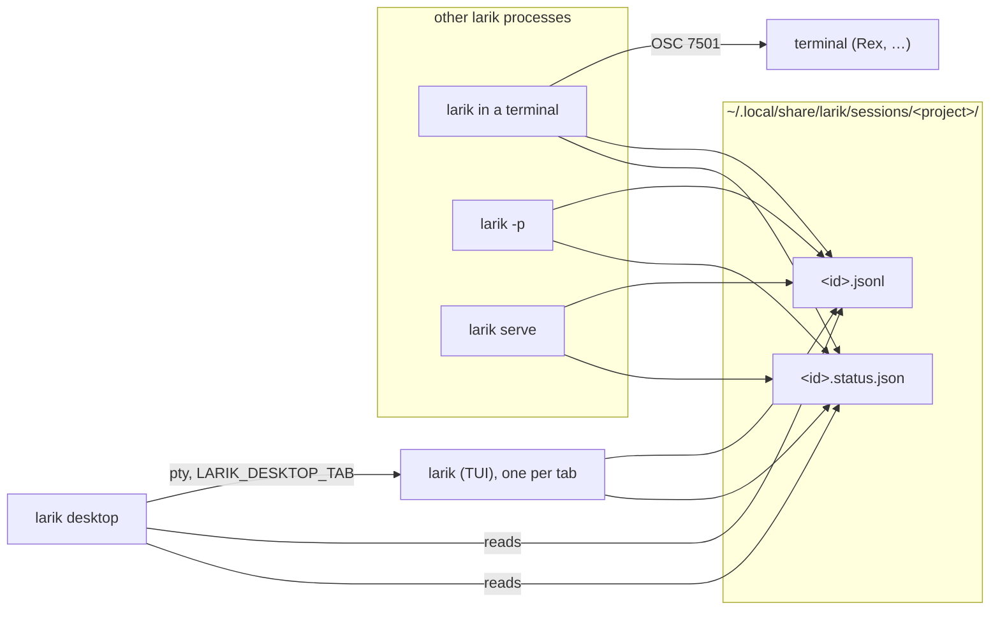

# Desktop app plan

A desktop window for Larik that shows every session from every project in one place, says which ones need you, and lets you work in any of them. Each open session is a terminal tab running the `larik` CLI, so the window is a terminal built around Larik's sessions rather than a second front end: everything the TUI does works there unchanged. It ships inside the `larik` binary as `larik desktop`, so there is nothing else to install.

This is a plan, worked through in phases. Each phase is useful on its own and lands before the next one starts. The status column below is kept up to date.

| # | Phase | Status |
|---|---|---|
| 1 | [Session status model and OSC 7501](#phase-1-session-status-model-and-osc-7501) | Done |
| 2 | [Live status files](#phase-2-live-status-files) | Done |
| 3 | [Cross-project session index](#phase-3-cross-project-session-index) | Done |
| 4 | [MyGo spike](#phase-4-mygo-spike) | Done |
| 5 | [Desktop shell: window, sidebar, terminal tabs](#phase-5-desktop-shell) | Done |
| 6 | [Panes: splits and changes](#phase-6-panes) | Done |
| 7 | [Inbox, notifications, keyboard, launcher](#phase-7-inbox-notifications-keyboard-launcher) | Done |
| 8 | [Commands and sidebar details](#phase-8-commands-and-sidebar-details) | Done |
| 9 | [Attention while the window is in front](#phase-9-attention-while-the-window-is-in-front) | Done |
| 10 | [Terminal tabs](#phase-10-terminal-tabs) | Done |
| 11 | [Answering in place](#phase-11-answering-in-place) | Done |
| 12 | [What's next](#phase-12-whats-next) | Planned |

## The design we're aiming for

The reference is [Rex](https://www.superlogical.com/rex), a terminal from Superlogical. What we take from it (its look we later left for macOS's own: see **macOS look** under phase 7):

- **One dark, translucent window** with the traffic lights and a host chip at the top left, and the open sessions as pill-shaped tabs in the title bar. Each tab carries a program icon and a thin coloured status stripe.
- **Content as tiled cards.** Each pane is a rounded card with a header: an icon, a title, and the directory (`Stress-test Snake demo | rex-snake`, `Git Changes ~/Sites/rex-snake`), and on the right split-horizontal, split-vertical, maximize and close buttons. Panes split freely in both directions.
- **Terminals as the content.** Rex's panes are terminals; ours run `larik`, so a session looks and behaves exactly as it does in any terminal.
- **Program status** as a protocol, not a guess: programs report `idle`, `working`, `done`, `blocked` (with a kind: `permission`, `question`, `auth`) or `error` over [OSC 7501](https://www.superlogical.com/rex/docs/build/program-status), and the window shows a spinner for working, symbols for blocked, and a marker for finished work you haven't looked at.

What we add for Larik:

- **A sidebar of every session from every project**, grouped by the directory it ran in. Rex's session picker shows terminals; ours shows Larik sessions, including ones that ran in a terminal and ones that ran here.
- **An inbox**: everything blocked on you, failed, or finished and unread, across all projects, at the bottom of the sidebar.

```
┌ ● ● ●  larik ─ MacBook   ( ⠋ refactor parser │ ⏸ add OSC 7501 │ ✓ release notes )        ⌘  + ┐
├──────────────────────┬────────────────────────────────────────┬──────────────────────────────┤
│ ▾ larik-hardness  ●2 │ >_ refactor the parser | larik-hardness│ ± Changes ~/Code/larik-…     │
│   ⠋ refactor parser  │ ▰▰▰ larik v0.25.0 · ~/Code/larik-…     │ M internal/parser/lex.go     │
│   ⏸ add OSC 7501     │ • Ran go test ./internal/parser        │ @@ -1,8 +1,11 @@             │
│   ✓ release notes    │   └ ok  larik/internal/parser 0.41s    │ -const WIDTH = 24            │
│   · fix trace view   │ • I split the lexer into …             │ +let WIDTH = 24              │
│ ▾ ornith/page        │                                        │                              │
│   ✕ deploy check     │ ┌──────────────────────────────────┐   │                              │
│ ▸ test-larik      2  │ │ › Ask larik…                     │   │                              │
│ ──────────────────── │ └──────────────────────────────────┘   │                              │
│ Inbox  1⏸ 1✕ 1✓      │                                        │                              │
└──────────────────────┴────────────────────────────────────────┴──────────────────────────────┘
```

## Architecture



- **Status is derived once** (`internal/status`) and published two ways: as OSC 7501 to the terminal the TUI runs in, and as a small status file next to the session that any process can read.
- **Each tab is a terminal running `larik`** (`larik --resume <id>` for a session from the sidebar), with MyGo's terminal plugin, which emulates it with Ghostty's libghostty-vt. The agent runs in its own process, as in any terminal, so a crash or a stuck tool can't take the window down, and there is no second front end to keep in step with the TUI.
- **The desktop reads the disk for the sidebar.** A tab's larik gets `LARIK_DESKTOP_TAB` in its environment and writes it into its status file, so the window knows which session a new tab went on to create, or switched to with `/resume`.
- **A session runs in one place.** A session file is locked by the process writing it, so a session open in another terminal shows its live status in the sidebar, and the window says where it is rather than opening a second larik on it.

## Phase 1: Session status model and OSC 7501

`internal/status` defines the five states, the three blocked kinds and a `Report` (state, kind, title, message). `osc.Status` encodes a report as OSC 7501: `ESC ] 7501 ; state=…:kind=…:app=larik:title=<base64>:msg=<base64> BEL`, within the spec's limits.

The TUI derives its report from its own state after every update and writes OSC 7501 only when it changes:

| TUI state | Report |
|---|---|
| a permission prompt is open | `blocked`, kind `permission` (`question` for `ask_user`), message says what for |
| a turn, recording or background task is running | `working` |
| the last turn failed | `error` |
| the last turn finished | `done` |
| just started, or the last turn was interrupted | `idle` |

On exit it sends `state=clear`, so a terminal doesn't keep showing a session that is no longer there. Terminals without OSC 7501 ignore the sequence. `"program_status": false` in config turns it off.

## Phase 2: Live status files

Every front end that owns a session (TUI, `-p`, `serve`) writes `<id>.status.json` next to `<id>.jsonl` when its report changes:

```json
{"pid": 4242, "state": "blocked", "kind": "permission", "msg": "needs your permission to use bash", "front_end": "tui", "updated": "2026-11-02T10:04:05Z"}
```

Writes are atomic (temp file and rename). A reader treats `working` and `blocked` from a process that is no longer running as `idle`, the same rule OSC 7501 gives terminals; `done` and `error` stay until the session is opened again.

## Phase 3: Cross-project session index

`session.Index(dataDir)` walks every project folder under `sessions/` and returns projects with their sessions and live status:

- **Grouped by the directory recorded in each session** (`meta.cwd`), not the folder name: older folders without a hash and the current hashed ones hold sessions for the same project.
- **Subfolders and worktrees grouped under their git repository**, each session labelled with its subfolder.
- **Scratch directories hidden** (anything under the system temp folders) unless asked for, and projects whose folder is gone marked as missing.
- Projects sorted by latest activity; sessions newest first.

`larik sessions` prints the index (`--all` includes scratch directories, `--json` for scripts and the desktop app).

## Phase 4: MyGo spike

The desktop uses [MyGo](https://mygo.egoist.dev)'s native UI: Go views drawn on the GPU, no webview and no cgo, so it can be compiled into `larik`. Before building on it, a throwaway spike answers:

1. Does a plain `go build` binary (no app bundle) open a window when run from a terminal on macOS?
2. How does MyGo take the main thread, and can `larik`'s `main` hand it over only for `larik desktop`?
3. Does a binary that links MyGo still start every other command on a Linux machine with no display, GTK or GL? If not, the desktop goes behind a build tag or into a separate binary.
4. Does the Markdown widget keep up with a long streamed reply, and does text selection work across messages?
5. Does IME composition work in the prompt box?
6. How much does it add to the binary size?

### What the spike found (MyGo v0.7.4, November 2026)

| Question | Answer |
|---|---|
| Plain binary, no bundle | **Yes.** A `CGO_ENABLED=0 go build` binary run from a terminal on macOS opened its window and drew it. |
| Main thread | MyGo's `init()` calls `runtime.LockOSThread()`, so the main goroutine stays on the main thread for every command once MyGo is linked, not just `larik desktop`. `mygo.App.Run()` then takes it over. Larik's other commands don't care which thread `main` runs on, so this is harmless, but it is a cost every command pays. |
| Headless Linux | **Should work; not run yet.** On Linux MyGo's `init()` only registers callbacks. GTK, GDK, cairo and GL are loaded with purego when the backend is first created, which happens when the first window opens. Every other command should start without them. This needs one run in a container without GUI libraries before phase 5 ships. |
| Streaming Markdown | `markdown.Stream` redrew at about 65 frames a second while 200 tokens arrived over 2 seconds, in a 480×320 window. Their `markdown-chat` example adds what a chat needs: replies revealed word by word, and a list that follows the end until you scroll up. |
| Selection across messages, IME | Not tested: both need someone at the keyboard. They're checked by hand at the start of phase 5. |
| Binary size | A Markdown window is 15 MB on its own. Linking only the packages adds 2.7 MB to a stripped `larik` (78 → 81 MB); expect 10–15 MB once the desktop uses them. |
| Go version | MyGo needs **Go 1.27.3**. Larik's `go.mod` says 1.27.1, so adding it raises Larik's minimum Go. `GOTOOLCHAIN=auto` (the default) downloads 1.27.3 by itself. |
| Testing | `ui.NewTester(view, w, h)` runs a view with no window, clicks and types as a user would, and `Image()` renders it. So the desktop can be tested in `go test`, and screenshots of it can be made without a display. |
| Terminal | MyGo's terminal plugin loads libghostty-vt (1.9 MB on macOS arm64) at run time, without cgo. Apps built with MyGo's CLI bundle it; a plain `go build` binary like `larik` downloads it once from MyGo's releases into the user's cache, checking its SHA-256. `$MYGO_GHOSTTY_VT` names another copy. It needs macOS 13, glibc 2.28 or Windows 10 1809. |

**Decision:** go ahead with MyGo's native UI, compiled into `larik`. The desktop code goes in `internal/desktop`, and `larik desktop` in `cmd/larik`. If the headless Linux run fails, the desktop moves behind a `desktop` build tag that release builds set on macOS and Windows only.

## Phase 5: Desktop shell

`larik desktop` opens the window from a terminal, detaches so the terminal gets its prompt back, and passes the shell's environment to its tabs (so provider keys work).

The first version of this phase drew Larik's own transcript, prompt box and permission cards, with a `larik serve` per directory behind them. It worked, but it was a second front end that would always trail the TUI: slash commands, `/rewind`, `/trace`, the browser panel, pickers and every shortcut would each need building again. Tabs now run the CLI in a terminal instead, and the window keeps what a terminal can't show: every project's sessions, what each is doing, and the inbox.

Built, in [internal/desktop](../internal/desktop/app.go) and `larik desktop`:

- The window, with a hidden title bar the view draws: the host, a pill per open tab with its status stripe, and a button for a new session.
- The sidebar from the index, refreshed every 1.5 seconds (6 ms on 330 sessions, since each file's scan is kept until it changes): sections per project, a status marker per session, unread checks and crosses, "Show N more", and the inbox with counts that open the newest of each. Sessions with a tab show a terminal icon.
- Terminal tabs: choosing a session runs `larik --resume <id>` in its directory; the new-session button runs `larik` in the open tab's directory. A tab follows its larik to whatever session it has open, through the tab tag in the status file. When larik exits cleanly its tab closes; when it fails the tab stays, with what it printed, and shows as an error.
- A card per tab with Rex's header: status icon, session title, project and subfolder, state and model, close.
- A session open in another terminal stays there: choosing it says so, since only one larik can have a session.
- "New session here" at the end of each project's section starts one in that project.
- The tabs come back at the next launch, resumed, with the split and the pane sizes, saved in `desktop/state.json` under the data directory as they change. Tabs that never started a session, and sessions open in another terminal by then, are left out. Without saved tabs the window opens the newest session of the directory it started in, unless that is the home directory, where the launcher starts it.
- Keys: Command+T new tab, Command+W close, Command+1–9 and Command+Shift+[ ] to switch (Control+Shift elsewhere, so Control keys stay larik's).
- `larik desktop` loads the terminal library before detaching, so a failed first download shows in the terminal rather than the log.
- Headless tests render the sidebar with fixture sessions, and run a fake `larik` script in real terminals to check resuming, new tabs, tab tags, failed and clean exits.

Still to check: the headless Linux run from phase 4. Once, on the first launch after the rework, the window drew its first frame and never redrew, while its tab's larik ran; it never came forward as the active app. It hasn't happened on any launch since, with or without detaching, nor in four detached launches against a separate data directory made to catch it.

## Phase 6: Panes

A second pane sits beside the main one, as one of two cards with Rex's header and controls, half and half to start and resizable. Rex splits both ways and as often as you like; one split side by side covers what Larik needs, and keeps the keys simple.

- **Splits**: the split button (⌘D) starts a new session in the focused tab's directory beside the main one; pressed in while split, the button closes the split, as the changes button closes the changes. The pane with the keyboard, in its terminal or its find bar, is the focused one: the sidebar, the title bar, ⌘W and new sessions follow it, and a session chosen in the sidebar opens there. Closing the split leaves its tab open; closing the main pane's tab hands the main pane to the split.
- **Changes** (⇧⌘G): the working tree of the main tab's repository against HEAD, a row per file, as Xcode lists changes, with a disclosure arrow, git's status letters, lines added and removed, and MyGo's diff viewer (unified, wrapped, with syntax colours), read again every two seconds while open, so it follows the agent's edits. Each file keeps its viewer, and whether it's folded, across reads. Up to 60 files show, and binary files and files over 512 KB are named but not shown. The pane follows the main tab: switching it to another project's tab shows that project's changes, and closing the last tab closes the pane and stops reading. Each read takes the files' text at HEAD from the last one while HEAD stays (git runs three times a read rather than once more per file: 190 ms down to 47 ms on a checkout with 41 changes).

The browser and trace panes in the first plan are dropped: the TUI's own browser panel and `/trace` work in a tab as they do in any terminal.

## Phase 7: Inbox, notifications, keyboard, launcher

- **Inbox** of blocked, failed and unread-finished sessions across projects at the bottom of the sidebar (phase 5), and the same count on the Dock icon.
- **Alerts**: when a session becomes blocked, or a turn that was working finishes or fails, while the window isn't focused, the Dock icon bounces and, where the system allows, a notification says which session; clicking it opens the session. macOS shows notifications only for app bundles, so they come with the launcher below, not with `larik desktop` run from a terminal.
- **Keyboard**: ⌘T new tab, ⌘O a new session in a folder you choose, ⌘W close, ⌘1–9 and ⇧⌘[ ] switch tabs, ⌘D split, ⇧⌘G changes, ⌘J the next session waiting for you (blocked first, then unread), ⌘K search, ⌘B hide or show the sidebar (also the button beside the host name), ⌘+ ⌘− ⌘0 the terminals' text size, all tabs at once, ⌘F find in the focused terminal. The window's keys reach it even while a terminal has the keyboard; the terminal's own ⌘K (clear screen) gives way to search. Off macOS they take Control+Shift.
- **Search**: the field at the top of the sidebar (⌘K) narrows every project's sessions to those whose title, project, directory or ID has each word typed, up to 50, across projects, and then those where each word was said: in a prompt or a reply, not in tool output or an attached file, with the passage under the session. Prompts and replies are a sliver of a transcript (4 MB of 788 MB across 542 sessions, on one machine), so the window keeps them in memory once a search first asks, reading them in the background (0.3 s for those 542) and then only what each transcript gained (2 ms), and a search takes a few milliseconds. Searching what was said starts at three letters, before which nearly every session would match. ↑ and ↓ choose a match, highlighted, and Enter opens it (the first to start with) and ends the search; Escape clears it, and a second Escape gives the keyboard back to the terminal.
- **Session menu**: right-clicking a session offers Open, Open in Split, Fork into a New Tab (`larik --resume <id> --fork`, so the original stays as it was), Copy Session ID, and Show Transcript in Finder. Right-clicking a tab in the title bar offers Open in Split, Close Tab, Close Other Tabs, and the last two for its session.
- **Remembered**: besides the open tabs (phase 5), the window keeps the split's width, the sidebar's width, whether it's hidden, which projects are folded, the text size, and the sessions hidden from it.
- **Closing a working tab** asks first, since it stops larik mid-turn; the session stays, so it can be resumed. Idle, blocked and finished tabs close at once, as does a tab whose larik exits cleanly. Closing the window (⇧⌘W or its close button) or quitting (⌘Q) asks the same while any tab is working, through the window's OnClose, which a quit goes through too; the tabs open again next launch.
- **One window**: one runs per data directory. It listens on a socket in the temp folder named after the data directory; a later `larik desktop`, from a terminal or the launcher, hands it the directory it ran in and exits, and the window comes forward on that directory's project: its newest session, or a new one where it has none (the home directory just brings the window forward). A socket left by a window that crashed is taken over. Two windows used to show the same sessions with tabs of their own and save over each other's tabs. MyGo's single-instance lock goes by the app's name, which would make windows on other data directories, as tests run, hand over to yours.
- **Menu bar** (macOS): AppKit hands a Command key to the menu bar before the window, and MyGo's default menu bar gave ⌘W to closing the window, every tab with it, and ⌘+ ⌘− ⌘0 to zooming a page the window doesn't have. Larik's own menu bar gives those keys the window's meanings (⌘W closes the tab, ⇧⌘W the window) and lists the other keys under File, Edit, View and Window. The terminal takes the Edit menu's Copy, Paste and Select All as commands, so those keys keep working through it. The headless tests drive the window's own shortcuts, which never see the menu bar, so this showed only on reading MyGo's AppKit code; a test checks that the menu's keys mean what the window's do and that no two items share one. The Window menu ends with the open tabs, as Safari's and Terminal's do, ⌘1–⌘9 on the first nine and a checkmark on the focused one, the menu bar set again when they change; the Help menu, with macOS's search field, opens Larik's README and this guide. About Larik is AppKit's own panel, told larik's version and name: run from a plain executable rather than an app bundle, it had none to show.
- **Project menu**: right-clicking a project offers New Session Here, Open in Finder, and Copy Path. A changed file in the changes pane offers Open, Show in Finder, and Copy Path.
- **Dock** (macOS): the Dock icon is Larik's, drawn as for the launcher, also when the window runs from a terminal, and its menu lists up to eight sessions waiting for you ("… — needs you", "— failed", "— finished") and New Session; choosing one brings the window forward on it.
- **Find** (⌘F): a bar under the pane's header searches the terminal's screen and scrollback with the terminal library's own search, highlighting matches and counting them ("2 of 5"). Enter goes to the next match up, Shift+Enter back down; Escape clears the text, then closes the bar and gives the keyboard back to the terminal.
- **Tab order**: dragging a tab onto another moves it to that place.
- **macOS look**: the window draws itself as a Mac app does, in place of Rex's warm palette, teal accent, pill tabs and floating cards. The sidebar runs the window's full height in macOS's sidebar material, with the traffic lights and a sidebar button over its top; the content is opaque under a unified toolbar that names the focused session, where it is and what it's doing, with the split, changes and new-session buttons. Tabs show in a tab bar, as Terminal's and Safari's, once there are two, filling its height; with one, the toolbar's title gives the tab's menu. Panes sit flush, with a slim header naming each only while split. Colours are macOS's (labels, separators, the system's green, orange and red), the accent is the one chosen in System Settings, icons are drawn thin, confirmations to close a working tab, close the window or quit are the system's sheets, and renaming happens in the sidebar's row, as in Finder. MyGo draws the controls itself, so they are close to AppKit's rather than AppKit's: the menu bar, context menus, Dock, sheets, folder picker and notifications are the system's own.
- **Settings**: ⌘, (Ctrl+Shift+, elsewhere), or Larik › Settings…, where Mac apps keep it, opens a tab running `larik /config` in the focused tab's directory, so the project's settings show beside the user's. The settings are larik's own panel rather than a window of the app's, since they are larik's settings: a second editor would have to be kept in step with it. A command after `larik` now runs as if typed, where before it went to the model as a prompt; only built-in commands' names count, so a prompt that starts with a path still goes to the model. Closing the panel leaves a new session in the tab. The app menu is MyGo's with this item added, About, Services, Hide and Quit as before.
- **Folders**: ⌘O, or File › Open Folder…, asks for a folder (with a New Folder button) and starts a session in it. A folder dragged from Finder or a file manager onto the sidebar, which lights up under it, does the same; a file starts one in its folder, and several give a tab each. Over a terminal a drop pastes the paths instead, as in any terminal.
- **Dragging sessions**: a session dragged from the sidebar onto a pane opens there: onto the split, into the split; onto the main pane, into it, swapping with the split when it was showing there; onto the split button, into a new split. The pane takes an accent border under it.
- **Window title**: the window is named after the focused tab's session ("… — Larik"), as the Window menu, Mission Control and the app switcher show it.
- **Restarting**: a tab whose larik failed shows a bar over what it printed, with its exit status and a Restart button; Restart, also in the tab's menu, runs larik again in the same tab and place, resuming its session (or a new one if it had none yet).
- **Reopening**: ⇧⌘T, or Reopen Closed Tab in a tab's menu (off macOS, where the window's keys take Shift already), resumes the session of the tab closed last, then the one before, up to 20; one that's gone or open again is skipped.
- **Hiding sessions**: "Hide from Sidebar" in a session's menu leaves it out of its project's list (search still finds it), and "Show N hidden" under the project brings hidden ones back to view, dimmed, where "Show in Sidebar" unhides one. A hidden session still shows while it's open in a tab or waiting for you, and doesn't count in the inbox once it finishes. Nothing is deleted; the window just remembers the list.
- **Renaming**: "Rename…" in a session's or a tab's menu turns the session's sidebar row into a field with the whole name selected, as Finder renames, showing the row first (the sidebar, its project, and the session even if hidden or past the first eight). Enter, or clicking away, names the session, as the sidebar, its tab, the window title, the Dock menu and alerts then show it, in place of its first prompt. The first prompt stays in the session's tooltip and the field's placeholder, and search finds either; a blank name gives the first prompt back, and Escape leaves it as it was. The names are the window's, kept with its state: `larik --resume` and `/resume` still list the first prompt.
- **Pinning**: "Pin to Top" in a session's menu moves it into a Pinned section above the projects, with its project's name, in the order pinned; "Unpin" puts it back in its project. Pinning a hidden session shows it again, and hiding a pinned one unpins it. The pins come back next launch; a session that's gone drops out. Dragging a session onto the Pinned section pins it where it's dropped, before the pinned one under it, and dragging pinned ones reorders them; while a session is dragged and nothing is pinned yet, the section shows to drop it on.
- **Ages**: each session in the sidebar shows how long ago it last changed (now, 5m, 3h, 2d, 4w), unless it has a status marker; the date and time are in its tooltip.
- **Launcher**: `larik desktop --install` writes `~/Applications/Larik.app` on macOS, or a `.desktop` entry on Linux, that starts `larik desktop` through your interactive login shell, as Visual Studio Code reads the shell's environment, so provider keys set in your shell profile work. `--uninstall` removes it. The bundle runs `larik` through a link inside it, so macOS takes the process for the app's and lets it show notifications (checked: the window reports them on from the bundle, off from a terminal); the first one asks for permission. The icon, Larik's three bars on the dark card, is drawn with MyGo's own renderer when installing, so there's no image file in the repository. It runs the `larik` you installed it from, so reinstall after moving the binary.

Still open: the headless Linux run from phase 4 (Linux and Windows builds compile; nothing has run on Linux yet).

## Phase 8: Commands and sidebar details

What [cmux](https://github.com/manaflow-ai/cmux) and [herdr](https://herdr.dev) have that the window didn't: a way for scripts and agents to drive it, and more about each project and session at a glance.

- **Commands**: `larik desktop <command>` sends the open window a request on its socket, as JSON, and prints the answer; `--json` prints the answer itself. A tab is named with `--tab`: its id, which larik in the tab has as `$LARIK_DESKTOP_TAB`, the id of the session it has open or enough of one to tell, or `focused`. A request is a JSON object where a handover was a bare directory, so `larik desktop` still hands one over as before, and a window from before commands says so rather than taking one for a folder.

  | Command | Does |
  |---|---|
  | `list` | the tabs: id, session, state, directory, title (`*` has the keyboard) |
  | `open [dir] [--session id] [--prompt text] [--split \| --background]` | a session in a tab, or a new one in `dir` (this directory by default), starting with the prompt; prints the tab's id. `--background` leaves the panes as they are |
  | `send --tab t [--no-enter] [text \| -]` | types the text and presses Return; several lines go as one paste; `-` or none reads stdin |
  | `read --tab t [--lines 50]` | the last lines of the tab's screen and scrollback (`0` for all) |
  | `wait --tab t \| --session id [--state done] [--timeout 10m]` | waits until the session is in one of the states (comma separated), and prints it. `done` and `error` say a turn ended, so only those reported after the wait began count, as after a `send`; `blocked`, `working` and `idle` count as they are. A tab whose larik failed answers `error` |
  | `focus --tab t` | shows the tab and brings the window forward |
  | `close --tab t [--force]` | closes the tab; one that's working only with `--force` |
  | `notify [--title t] text` | posts a notification, and shows it in the window |

  ```sh
  tab=$(larik desktop open ~/Code/site --background --prompt "run the tests and fix what fails")
  larik desktop wait --tab "$tab" --state done,error,blocked --timeout 30m
  larik desktop read --tab "$tab" --lines 20
  ```

  Each connection is served on its own, so a wait doesn't hold the others up; the commands run on the window's main thread, and a wait reads the session's status file every 0.4 s between asking it which session the tab has.
- **Branch and changes**: each open project's section names the branch checked out and how many files changed (`larik-hardness · main ±3`), the commit when detached. A session running in a worktree on another branch shows that branch under its row.
- **What a session is doing**: while a session works or waits for you, the line under its row says what, as its status says it ("needs your permission to use bash").
- **Ports**: the TCP ports that a tab's larik, or anything it started, listens on show under the session's row (`:5173`), each opening `http://localhost:<port>` in the browser, as cmux shows a workspace's. They come from `ps` and `lsof`: the processes under each tab's larik, and those on its terminal, as a server started with `&` from a shell that has since exited, which leaves it to launchd (macOS and Linux). A server that detaches from the terminal (`setsid`, a daemon) doesn't show.
- These are read every three seconds off the main thread: `git status --porcelain=v2 --branch` once per open project, or per worktree a session runs in, and `ps` and `lsof` once for every tab. Folded projects aren't read.

## Phase 9: Attention while the window is in front

Alerts tell you only from another app: while you work in one tab, a session in another could start waiting for you, or finish, with nothing but its sidebar marker to say so. cmux rings the pane and lights the tab; Larik now does the same, and keeps what it would have told you.

- **Rings**: a tab whose session waits for you, or finished or failed since you last had it focused (or since the window opened), takes a ring and a tint in its status colour in the tab bar, and so does its pane while it shows in the split without the keyboard. Focusing it ends the ring. The tab with the keyboard never rings.
- **Notifications**: every alert is kept, whether or not the window was in front, with what `larik desktop notify` posted, up to the last 100. The bell in the toolbar counts those you haven't seen and opens their list, newest first: what each session did, when, a dot on those unread, and **Mark All Read**. Choosing one opens its session. One about the session you're looking at is read as it comes, and looking at a session reads all of its.
- **The newest unread**: ⇧⌘U (Window › Latest Notification; Ctrl+Shift+U elsewhere) opens what the newest notification you haven't seen is about, the way ⌘J goes through what waits for you now.

## Phase 10: Terminal tabs

Rex and cmux are terminals first: a shell, lazygit or a dev server sits beside the agents. The window ran only larik; now a tab can run your shell, or a program through it.

- **New Terminal** (⇧⌘N, File › New Terminal, right-clicking the toolbar's **+**, or the empty window's **New terminal**) opens your login shell (`$SHELL -l`) in the focused tab's directory. `larik desktop open --shell [dir]` does the same from a script, and `--run "lazygit"` runs a program there through your interactive shell (`$SHELL -ilc`), so your profile's PATH and aliases work. Like larik's tabs, a terminal tab closes when its program exits cleanly, and stays, with Restart, when it fails; it splits, drags, finds and reads (`larik desktop read`) as they do, and `list` says `"kind": "terminal"`.
- **Terminals** in the sidebar, above Pinned, lists them, with a bell on one that rang while you looked elsewhere.
- **What a program says**: a notification it posts (OSC 9, OSC 777, as `printf '\e]9;dev server ready\a'`) goes into the bell's list, rings the tab while you look elsewhere, and tells you from another app; so does its bell, as a ring. The terminal library hands over no other sequences, so a program's own OSC 7501 status isn't read yet.
- **larik in a terminal**: the tab's id is in the shell's environment, so a larik started there writes it into its status file, and the tab shows that session's title and status, rings as larik's own tabs do, and goes back to being a terminal when larik quits.
- **Remembered**: terminal tabs come back next launch in their place, as your shell in their folder. A program tab comes back as a shell too: running a dev server or a script again as the window opens isn't for the window to decide.
- In `list` and `read`, what a blocked session waits for is now `wants` (it was `kind`, which now says what the tab is).

## Phase 11: Answering in place

A session waiting on a permission was a tab away: you went to it, pressed `1`, and went back. Now you can answer it from wherever you see it.

- **Where**: under a waiting session's row in the sidebar, and under its newest notification in the bell's list, are **Allow**, **Always** and **Deny**; right-clicking the session or its tab offers **Allow**, **Always Allow** and **Deny** too. A plan to review offers **Approve** (accept edits), **Approve, Ask** (ask before each edit) and **Keep Planning**, in its prompt's words, with what each does in its tooltip. A question or a sign-in needs words, so it has no buttons: opening the tab answers those.
- **How**: the window types the key larik's prompt takes into the tab, as you would: `1` for the first option, `2` for the second, Escape for no. Only a session open in a tab here, whose larik runs, can be answered; one in another terminal says to open it there.
- **Checked**: the session's status file is read again just before, so a prompt that came after the last index (a second or so) is answered and one already answered in the tab isn't; and after, so that if the session hasn't moved on within 2.5 s the notice bar says the tab didn't take it. The diff open in the prompt, or the field for telling larik what to do instead, takes keys first. A second click on the same prompt, while the first is on its way, does nothing; the buttons come back once the session moves on.
- **From a script**: `larik desktop allow --tab t [--always]` and `larik desktop deny --tab t` answer the same way, and print the state the session moved on to (`working`, or `blocked` again for the next prompt), or fail when nothing waits or the tab didn't take the answer. So an agent driving the window can review and answer another's prompts:

  ```sh
  larik desktop wait --tab "$tab" --state blocked
  larik desktop read --tab "$tab" --lines 15   # what it asks
  larik desktop allow --tab "$tab"
  ```

## Phase 12: What's next

From a review against [Rex](https://www.superlogical.com/updates/public-testing-beginning), cmux and herdr, roughly in order of what each is worth for what it costs:

- **Program status from any program**: OSC 7501 read from what runs in a terminal tab, which needs the terminal library to hand the sequence over.
- **Asking before closing a busy terminal**, as Terminal does when a program is still running in it.
- **A rendered plan to review**, beside the prompt, as cmux's markdown panel, and answers from the system notification itself.
- **Worktrees**: a new session in a new worktree and branch, and merging or removing it when done.
- **Changes you can act on**: stage, discard and commit per file and hunk, compare with the base branch, open a PR, and the changes beside a split.
- **Splits** in both directions and more than two, resized by dragging, moved between by keys.
- **Cost and context** in the status file, and on screen: cost, context used, model, permission mode.
- **A command palette**, archiving and deleting sessions, names that `/resume` shows, and settings of the window's own (keys, theme, font).
- **Sessions that outlive the window**, as Rex and herdr keep theirs: a background host the window attaches to, then remote windows on another Mac or over SSH.

Still open from phase 7: the headless Linux run.

